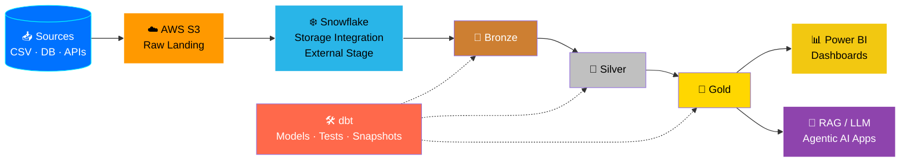

<!-- Repo: adiii-dhande/adiii-dhande  →  README.md -->

<div align="center">



<br/>


</div>

---

## 🧬 `whoami`

```python
class AdityaDhande:
    role       = "Data Engineer | Data & AI"
    education  = "B.Tech, Electronics & Telecommunication (YCCE Nagpur)"
    data_eng   = ["ELT/ETL Pipelines", "dbt", "Snowflake", "Spark", "Airflow", "Kafka"]
    ai         = ["Generative AI", "LLMs", "RAG", "Agentic AI"]
    cloud      = ["AWS (S3, IAM, Glue, Lambda, Redshift, EMR, EC2)", "Azure"]
    pipeline   = "Source → S3 → Snowflake → dbt (Bronze/Silver/Gold) → BI / AI apps"
    open_to    = "Mumbai · Pune · Hyderabad · Bangalore · Remote 🇮🇳"
    mindset    = "Reliable data pipelines are the foundation of every great AI system."
```

- ⚙️ Build **ELT pipelines** with **dbt + Snowflake + Spark** using **medallion (Bronze/Silver/Gold)** architecture
- 🧱 Strong in **data modeling**: Star Schema, SCD Type 2, facts & dimensions, incremental loads
- ✅ Data quality first: validated **200K+ records** with SQL & Python, automated checks and dbt tests
- 🤖 Bridging **Data → AI**: **Generative AI, LLMs, RAG & Agentic AI** powered by clean, governed data
- ☁️ Cloud: **AWS** (S3, IAM, Glue, Lambda, Redshift, EMR, EC2) and **Azure**
- 📊 BI-ready: **Power BI + DAX** dashboards on top of the gold layer

---

## 🔄 Data & AI Architecture



---

## 🛠️ Tech Stack

### 🏗️ Data Engineering


### 🤖 Data & AI


### ☁️ Cloud


### 🧮 Languages & Databases


### 📈 BI & Analytics


### 🧰 Dev Tools


---

## 🚀 Featured Projects

<table>
  <tr>
    <td width="50%" valign="top">

### ❄️ Airbnb Data Engineering Pipeline (AWS + Snowflake + dbt)
End-to-end **cloud ELT pipeline**: 5.7K+ Airbnb records (bookings, listings, hosts) from **AWS S3 → Snowflake**, transformed through **Bronze / Silver / Gold** with **11 dbt models**.

- ☁️ Secure S3 → Snowflake ingestion using **AWS IAM**, **Storage Integration** & **External Stages**
- ⚡ Incremental models with unique keys, so only new/changed rows load
- 🕰️ **3 dbt snapshots (SCD Type 2)** for history tracking
- 🧩 **4 reusable Jinja macros** + config-driven joins
- ✅ dbt tests (not-null, unique, business rules) between layers
- ⭐ Fact & dimension tables + one-big-table model for analytics


[](https://github.com/adiii-dhande/Airbnb-Snowflake-dbt-Pipeline)

</td>
    <td width="50%" valign="top">

### 🛒 E-Commerce Customer & Sales Analytics
Full analytics workflow: **Pandas cleaning**, **MySQL analysis** and an **interactive Power BI dashboard** with DAX KPIs, on 128 fictional transaction lines (Jan to Oct 2025).

- 🧹 Cleaned missing values, duplicates, cancelled & inconsistent records
- 🔎 Revenue trends, top products, repeat-purchase behavior
- 🌍 Country-level sales insights with a country tile slicer
- 📊 DAX KPIs: net revenue, orders, customers, AOV, plus month-over-month trend badges
- 📝 Documented KPI definitions, assumptions, findings and recommendations


[](https://github.com/adiii-dhande/E-Commerce-Customer-Sales-Analytics)

</td>
  </tr>
  <tr>
    <td colspan="2" valign="top">

### 🤖 Agentic AI Data Pipeline Assistant &nbsp; 
AI-powered data engineering assistant that uses an LLM agent to automate data ingestion, cleaning, validation, SQL generation and pipeline troubleshooting through natural-language instructions.

- 🧠 Natural-language to pipeline / SQL generation
- 📂 Automated dataset ingestion & schema profiling
- 🧹 AI-assisted cleaning & data-quality detection
- 🔍 Automated validation & pipeline error analysis
- ⚡ SQL generation and query optimization
- 🔄 Agent workflow: plan → execute → validate → report


[](https://github.com/adiii-dhande/Agentic-AI-Data-Pipeline-Assistant)

</td>
  </tr>
</table>

---

## 📊 GitHub Analytics

<div align="center">


<br/>


<br/>


</div>

---

## 🏆 Certifications

-0B3D91?style=for-the-badge)


---

## 📫 Let's Connect

<div align="center">

[](https://www.linkedin.com/in/aditya-dhande-17a851255/)
[](https://adittyyad.lovable.app/)
[](mailto:adityadhande35@gmail.com)

<br/>

```sql
SELECT 'Let''s build scalable data pipelines for AI' AS message;
```

</div>
